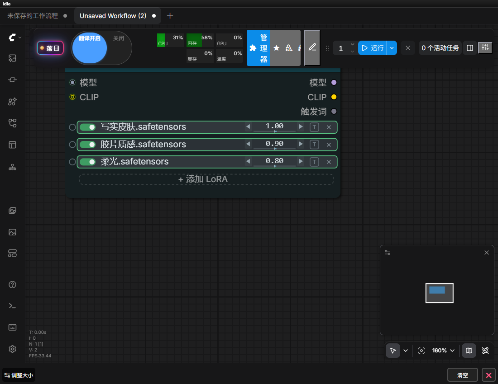
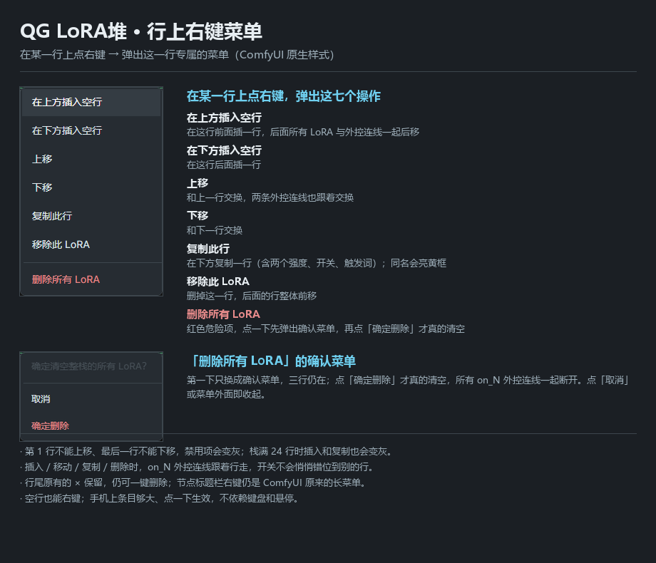
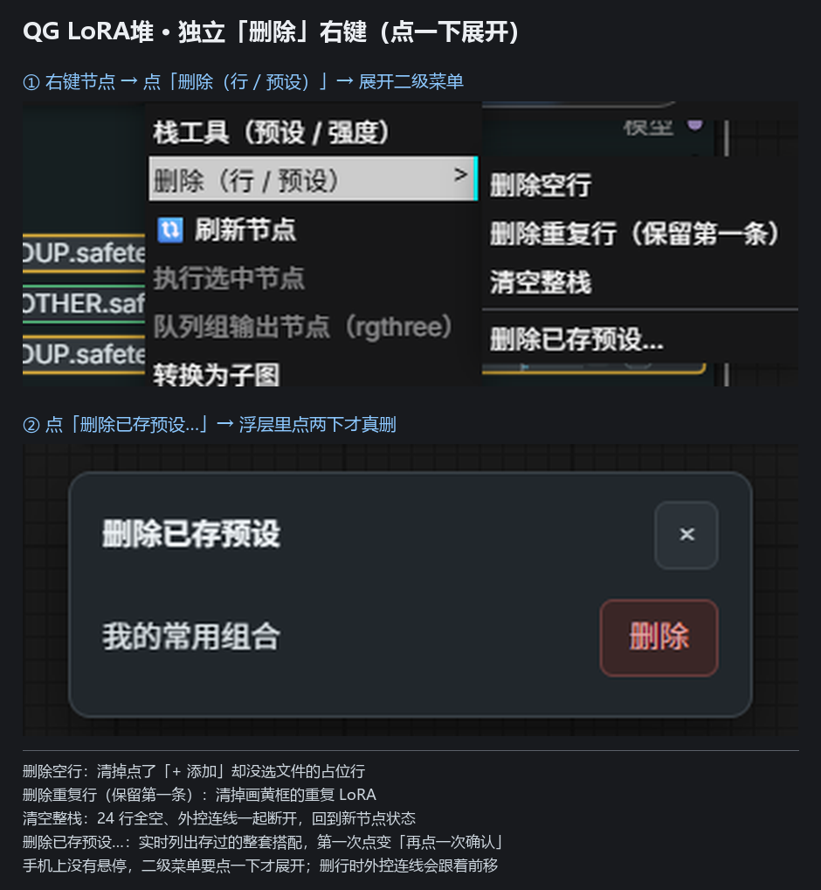
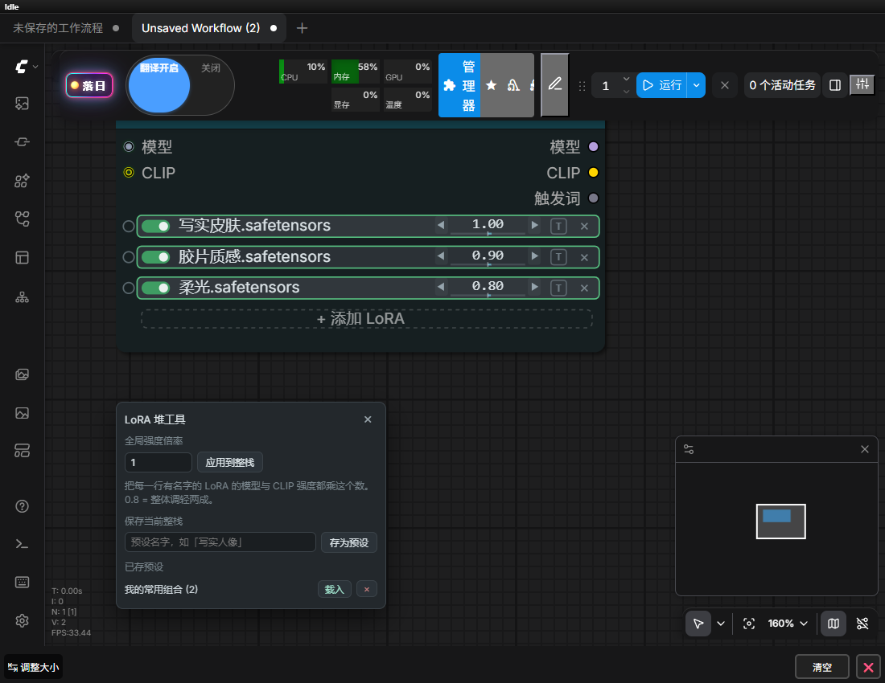
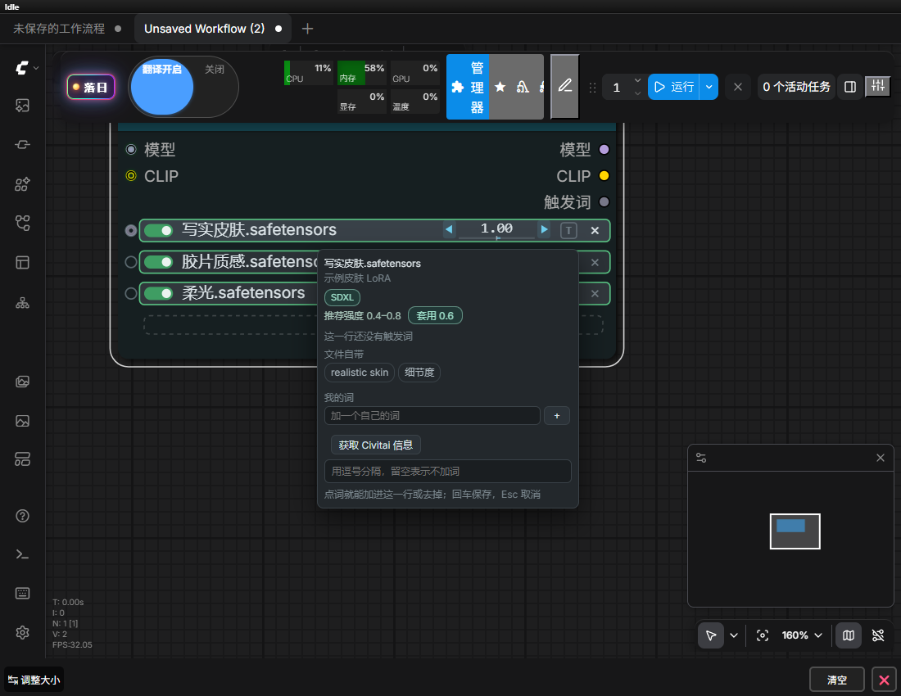

# QG LoRA堆 · 栈工具使用说明

适用版本：0.9.22（第一层扩展 + 行上右键菜单 2026-11-12/13；第二层整理栈 2026-11-20；第三层新机制 2026-11-20；标题栏齿轮入口 2026-11-20；每行强度外控 2026-11-20；共用完整设置面板 2026-11-20）
适用节点：`QG_LoraSwitchStack` / 中文界面显示名「QG LoRA堆」

第一层加了四个功能，另外配了**行上右键菜单**（针对某一行）和一个**独立的「删除」菜单**（针对整栈），都是**在原来那个节点上操作**，没有新增节点，也没有改变节点的输入输出接口。你原来的工作流、存档、连线全部不用动。第二层（见第九节）再加 Alt 拖排序、文件夹筛选、批量反选/独奏、整栈导入导出，同样不改接口。第三层（见第十节）再加种子组合、批量外控、缺失体检、触发词复制，依然全在前端，接口一行没动。

> 🔴 **入口变更（2026-11-20）**：整栈级的三个入口（栈工具 / 删除 / 整理栈）已从**节点右键菜单**收进**节点标题栏的齿轮⚙**（外观和「导出图像」节点的齿轮一致，位于「?」帮助徽标左边）。经典画布和 Nodes 2.0 两种模式都有齿轮；节点右键菜单不再出现这三项，其余插件（如 rgthree）的右键项不受影响。下面正文里凡是写「节点右键 → 栈工具 / 删除 / 整理栈」的地方，一律改看**标题栏齿轮**；**行上右键菜单**（第二节）保持不变。

> 生效方式：整层扩展改了后端（`nodes/_qg_lora_helpers.py` 新增了预设接口），
> 所以**需要重启一次 ComfyUI**。重启后浏览器按普通刷新即可（入口脚本不缓存）。
> 只刷新不重启的话，预设会保存失败，其余功能正常。
> 后面追加的「删除」右键、以及最后改成的「行上右键菜单」都只改前端，单独更新时普通刷新就够。

---

## 一、四个操作入口

| 入口 | 在哪儿 | 用途 |
|---|---|---|
| 行上右键菜单 | 在 LoRA 堆的**某一行**上点右键 | **单行操作**：插空行、上移下移、复制、移除、删全部 |
| 设置 | **节点标题栏齿轮⚙**第一项 | 与 LoRA 加载器共用的 13 项偏好（强度、名称、缺文件、Civitai 等） |
| 栈工具（预设 / 强度） | **节点标题栏齿轮⚙**第二项 | 打开面板：存/取预设、全局强度倍率 |
| 删除（行 / 预设） | **节点标题栏齿轮⚙**第三项 | **整栈批量**：删空行、删重复行、清空、删预设 |
| 整理栈（筛选 / 批量 / 导入导出） | **节点标题栏齿轮⚙**第四项 | 第二、三层的全部新功能 |
| 吸收链式 LoRA | **节点标题栏齿轮⚙**第五项 | 把模型链上下游的 LoRA 加载器搬进本堆并旁通它们 |

「设置」「栈工具」和「整理栈」点一下打开面板；「删除」点一下展开二级菜单（手机没有悬停）；「吸收」点一下直接执行。菜单各项**点文字即可**，右侧没有「打开」按钮。齿轮在标题栏右侧、「?」帮助徽标左边；经典画布直接点，Nodes 2.0 下是真 DOM 按钮。
「设置」面板里的 13 项与 LoRA 加载器共用同一份偏好，改一处两个节点都生效；只有「模型 / CLIP 强度分开」按当前节点单独记，不写进共享偏好。打开后强度步进、默认强度、名称显示、强度条、Civitai 按钮都会立即作用到这个节点。齿轮菜单里还有一项 **「吸收链式 LoRA」**（第五项，点文字执行，不在设置面板里）：沿本节点的模型链往上下游走，把遇到的 LoRA 加载器（含其它插件的加载器）搬进这一堆，再旁通那些节点，出图结果不变。上游的行排在最前、本堆原有行居中、下游的行排在最后；同一文件出现两次就留两行（本来就是打两次补丁）。**如果哪一行接了外控开关或强度线，吸收会被拒绝**并提示先断开——因为行要重排，连线绑的是槽位、会跟错行。
「预览缩略图」开着时，鼠标停在这一堆某一行的**名字**上，会和 LoRA 加载器一样在旁边弹出那行的预览图；拖强度、拖行排序或把鼠标移开时自动收起。关掉这个设置则两处都不弹。
在**某一行**上点右键，弹出的就是这一行的菜单，样式和 ComfyUI 自带右键菜单一样；在节点标题或空白处右键，仍然是 ComfyUI 原来的长菜单。

## 二、行操作菜单（在行上点右键）

**什么时候用**：想在第 2 行前面插一个 LoRA、把某几行换个顺序、复制一行做 A/B 对比，或者一键清空整个栈。以前只能删掉重建，现在直接在这一行上操作。

### 怎么打开

把鼠标移到想改的那一行，**点右键**（手机上一般是长按或双指点按，取决于浏览器）。菜单就出现在鼠标位置，是这一行专属的；空行也能右键，照样能插入、复制、换顺序。行尾不再有「三点」按钮，触发词 `T` 与删除 `×` 之间只留了一点空白。

菜单用的是 ComfyUI 原生右键菜单：悬停高亮、点外面收起、按 `Esc` 收起都由前端负责。点完一项自动收起；不想选就点菜单外面。

### 七项功能

| 选项 | 做什么 |
|---|---|
| 在上方插入空行 | 在这行**前面**插一行，后面所有 LoRA 与外控连线一起后移 |
| 在下方插入空行 | 在这行**后面**插一行 |
| 上移 | 和上一行交换，两条外控连线也跟着交换 |
| 下移 | 和下一行交换 |
| 复制此行 | 在下方复制一行（名字、两个强度、开关、触发词全带过去）；同名会亮**黄框**提醒 |
| 移除此 LoRA | 删掉这一行，后面的行整体前移 |
| 删除所有 LoRA | 红色危险项，点一下先弹出确认菜单，再点「确定删除」才真的清空 |

几个细节：

- **第 1 行不能上移、最后一行不能下移**，这两项会变灰，点了没反应。栈用满 24 行时，插入和复制也会变灰。
- **外控连线跟着行走**：插入时后移、删除时前移、上下移时交换，开关始终控制原来那个 LoRA，不会悄悄错位。真机专门验过。
- **行尾原有的 `×` 保留**，仍可一键删掉那一行；菜单里的「移除此 LoRA」是同一件事。
- 「删除所有 LoRA」是二次确认：第一下菜单原地换成「确定清空整栈的所有 LoRA？」加「取消 / 确定删除」，三行还在；点「确定删除」才清空，所有 `on_N` 外控连线一起断开。

## 三、整栈删除菜单（齿轮第二项）

**什么时候用**：24 行逐个去点行尾那个很小的 `×` 太累，手机上尤其难点中；或者想一次清掉空行、重复行、整个栈，以及删掉存错的预设。

### 怎么打开

1. 点 **QG LoRA堆 节点标题栏的齿轮⚙**（「?」左边）。
2. 点 **「删除」**，二级菜单展开。
3. 直接点里面那一项，不用再进「栈工具」面板。

🔴 **手机上没有悬停**：二级菜单必须**点一下**才展开，光把手指停在上面不会出来。桌面端也一样（这是当前前端的菜单行为，不是本节点特有）。

### 四个选项

| 选项 | 做什么 | 会不会动外控连线 |
|---|---|---|
| 删除空行 | 清掉点了「+ 添加 LoRA」却没选文件的占位行，有名字的行自动收紧到前面 | 空行自己的线会断开，其余跟着前移 |
| 删除重复行（保留第一条） | 把画**黄框**的同名 LoRA 只留第一条 | 重复行的线断开，其余跟着前移 |
| 清空整栈 | 24 行全空、可见行归零，回到刚拖出来的新节点状态 | 所有 `on_N` 外控线一起断开 |
| 删除已存预设… | 打开一个轻量浮层，实时列出存过的整套搭配 | 不动节点 |

删完会在右上角弹一条中文提示，告诉你删了几行；没有可删的东西也会明确提示，不会静默无反应。

### 删行时连线怎么办

删掉中间某一行时，后面的行会整体前移，**接在 `on_N` 上的外控连线也会跟着一起前移**（比如原来接在第 3 行的线，删掉第 1 行后会落到第 2 行），开关不会悄悄控制到别的 LoRA 上。这一点在真机探针里单独验过。

### 删除已存预设

点「删除已存预设…」后，浮层出现在**节点下方的空白画布**，列出所有预设名，每条右边一个红色「删除」按钮：

- **第一次点**：按钮变成「再点一次确认」，预设**不会**被删；
- **第二次点**：才真正删掉，列表立刻刷新；
- 点浮层外面或右上角 `×` 关闭。

要两次确认是因为预设删掉不可恢复，手机上误触代价太高。日常只想快速删一个，也可以走「栈工具」面板里那个 `×`（那个是点一下就删）。

---

## 四、栈工具面板

点 **「栈工具（预设 / 强度）」** 打开面板。

面板默认贴在**节点右侧**（右缘 + 14px，顶部与标题栏对齐），不遮挡 LoRA 行；节点右边放不下时会夹在视口右缘，不会再翻回节点左下。点面板外面或右上角的 `×` 关闭。

面板里分三块：

| 区块 | 干什么 |
|---|---|
| 全局强度倍率 | 一次调轻 / 调重整栈所有行 |
| 保存当前整栈 | 给当前这套搭配起个名字存起来 |
| 已存预设 | 载入 / 删除以前存的搭配 |

---

## 五、整栈预设（存 / 取 / 删）

**什么时候用**：你调好一套 LoRA 组合（比如「写实人像」用 3 个 LoRA、强度各不同），想换个工作流接着用，或者想留个备份随时切回来。以前只能复制整个节点，现在存成预设就行。

### 保存

1. 点节点标题栏齿轮⚙ → 「栈工具」。
2. 在「保存当前整栈」下的输入框里填名字，例如 `写实人像`。
3. 点 **「存为预设」**。列表里立刻出现这个名字，括号里的数字是有几行 LoRA。

同名会**覆盖**，不会生成重复条目——改了强度直接再存一次同名即可。空栈不能存（会提示）。

### 载入

在「已存预设」列表里找到名字，点 **「载入」**：

- 每个 LoRA 回到**保存时所在的那一行**（空行占位也保留），`on_N` 外控连线不会因为载入预设而指到别的行；
- 没有内容的槽位清空，不会残留上一次的行；
- 11-12 之前存的老预设没有位置信息，仍按顺序铺到前几行（行为不变）；
- 节点高度自动重算，不会多出空行；
- 载入后面板自动关闭。

🔴 **载入会替换当前节点里的行**，不是追加。想保留当前搭配，先把它另存一个名字。

### 删除

点预设名右边的 `×`，后端记录一并删掉。

### 存在哪里

`ComfyUI 用户目录 / QG-tools / lora_stack_presets.json`，**跨工作流、跟着你的用户目录走**，不在工作流文件里。换电脑时把这个文件拷过去即可。最多 60 个预设、每个名字最多 60 字、每份最多 24 行。

安全性：读写用同一把锁、先写临时文件再原子替换；文件损坏时**拒绝覆盖**并报错，不会把你已经存好的预设清空。

---

## 六、全局强度倍率

**什么时候用**：一整套 LoRA 整体太浓 / 太淡，想统一压到八成，不想一行一行拖 24 次。

1. 点节点标题栏齿轮⚙ → 「栈工具」。
2. 「全局强度倍率」输入框里填倍数，例如 `0.8`。
3. 点 **「应用到整栈」**。

- 每一行**有名字的 LoRA** 的「模型强度」和「CLIP 强度」都会乘这个数；
- 结果仍受原来的强度上下界限制；
- 空白行不动（不会被悄悄改成 0.8）；
- 只接受大于 0 的数，填 0 或负数会提示。

🔴 这是**一次性操作**，直接把结果写进每一行，面板里没有"恢复到 1.0"的按钮。想反悔就填倒数（0.8 之后填 `1.25`），或者用上一节的预设：先存一份，调完不满意再载入回来。

> 实现说明：倍率是前端把每行强度算好后写回 `rows_data`，后端接口一个字没改。所以缓存、存档格式、节点登记都不受影响，也不会和 `on_N` 外控开关打架。

---

## 七、推荐强度一键套用 + 底模徽标（在触发词卡片里）

**什么时候用**：你给某个 LoRA 存过推荐强度区间，或者想知道这个 LoRA 到底是给哪个底模训的（喂错底模是最常见的"加了没效果"原因）。

1. 点**行尾那个带 T 的小方块**（行尾 `×` 左边），打开触发词卡片。卡片是横版的：左边放这张 LoRA 的缩略图，右边集中放标题、底模、推荐强度、触发词和 Civitai 操作。
2. 卡片顶部现在多了一行元信息：

| 元素 | 含义 |
|---|---|
| 彩色徽标（如 `SDXL`、`Flux`） | 这个 LoRA 声明的底层模型。没声明就不显示 |
| `建议强度 任意 至 任意` | 可填的建议区间：两端都能拖动、点击输入或按箭头步进，清空就是「任意」。落定后自动存到这个 LoRA 的配置里；填了边界还会硬限制这一行的强度可调范围 |
| `套用 0.6` 按钮 | 有区间才出现；把这一行的模型强度和 CLIP 强度都设成区间中值 |

3. 点 **「套用 0.6」**，这一行两个强度立刻变成 0.6，按钮变成「已套用」。

几个细节：

- 底模和推荐区间都来自插件**早就有的** `/qg/lora/info` 数据（文件元数据 + Civitai 侧车 + 你自己存的配置），没有新增联网请求；服务器从不访问 Civitai。
- 「建议强度」两端留空就是「任意」；只填一端也能套用，中值按那一端算。保存区间时只发区间本身，不会把卡片里刚加、还没关掉时改过的自定义词冲掉。
- 填了边界后是**硬限制**：这一行的模型强度和 CLIP 强度在拖动、左右箭头、手动键入、批量倍率时都会被夹进区间；没填的一端继续用全局上下界。存档里原本就在区间外的数值不会被偷偷改写，等你下一次调整它时才夹进来。
- 只设了区间一端（比如只有上限 0.8）也能用，中值按那一端算。
- 套用**只改当前这一行**，不影响别的行。
- 底模徽标是**提示**，不是校验：插件不会阻止你把 SDXL 的 LoRA 接到 Flux 上。真正"一个权重都没打上"时，后端仍会照常在控制台给警告。
- 「触发词」（自己加的词）分区里每个自定义词后面都有一个红色 `×`：点它会同时从保存的词库和当前行移除，推荐强度区间保持不变。新的词加进去后立刻就能看到这个删除按钮。

---

## 八、常见问题

**问：节点标题栏找不到齿轮⚙，或点齿轮没反应？**
2026-11-20 起整栈入口已收进标题栏齿轮（「?」左边），**节点右键菜单里不再有「栈工具 / 删除 / 整理栈」**，这是预期行为。经典画布齿轮是画上去的，Nodes 2.0 下是真按钮。若齿轮完全不出现，重启 ComfyUI 后按 `Ctrl+Shift+R` 强刷一次。

**问：点了「删除」没反应、没列出选项？**
二级菜单要**再点一下**才展开，悬停不会展开（手机尤其注意）。

**问：存预设没反应 / 提示失败？**
基本都是没重启 ComfyUI——后端新增的接口还没加载。重启后重试。

**问：节点在新版节点界面（Nodes 2.0）下能用吗？**
能。这四个功能都在**标题栏齿轮菜单**和 DOM 面板里，与画布渲染方式无关；经典画布齿轮自绘、Nodes 2.0 是真 DOM 按钮，两种模式都验过。

**问：行菜单在哪儿？行尾怎么没有按钮了？**
按用户要求改成了**行上右键菜单**，行尾的三点按钮已经去掉。想改哪一行就在那一行上点右键；节点标题栏、空白画布上右键仍是 ComfyUI 原来的菜单。整栈批量操作请用**标题栏齿轮**里的「栈工具 / 删除 / 整理栈」三项。

**问：手机上怎么操作？**
面板和预设删除浮层是普通网页浮层，按钮够大、可以点、可以输入文字，不依赖键盘和悬停；行菜单用的是 ComfyUI 原生右键菜单，条目的点击区域同样是整行宽，点一下就生效，不依赖悬停。齿轮菜单的「删除」点一下就展开二级菜单，行菜单里的「删除所有 LoRA」也是点一下才弹确认。

---

## 九、第二层：整理栈（2026-11-20）

第二层四项都是**纯前端**改动：节点接口、后端、`rows_data` 存档格式一行没动，原有工作流和连线不用改。入口是标题栏齿轮的**第三项「整理栈（筛选 / 批量 / 导入导出）」**；另外「独奏此行」在**行上右键菜单**里。

### 9.1 Alt + 拖名字区重排

- 在某一行的**名字上按住 `Alt` 再拖动**，经过哪一行就和哪一行交换位置，松手落位。
- 普通点击名字照旧打开 LoRA 选择器；强度区拖动、行尾 ×、行右键菜单都没变。
- **外控连线跟着行走**：交换时两条 `on_N` 连线连同源节点一起互换，开关始终控制原来那个 LoRA（走官方断连重连接口，不用已弃用的 `input.link` 赋值）。

### 9.2 按文件夹筛选（仅视图）

- 打开「整理栈」面板，在「按文件夹筛选」下拉里选一个文件夹（含上级目录；根目录单独一项）。
- 不属于该文件夹的行**名字变暗并标「（已筛选）」**，仍留在原位。
- 这是**视图标记，不是隐藏或重排**：行号、`on_N` 槽位、存档顺序全部不变——所以外控开关不会指错行。选「全部文件夹」清除。

### 9.3 批量反选 / 独奏

- **反选所有行**：把每个有名字的行的开关取反；空行不参与。
- **独奏此行**（行右键菜单）：只留这一行开着，其余行记下当前状态后关掉；面板里点「取消独奏」或再点一次独奏，用快照**逐行还原**，不猜原值。
- 有外控连线的行仍由连线决定开关——这些操作只改存档里的 `enabled`，不与连线打架。换整栈（载入预设 / 导入）时独奏快照自动清掉，避免把旧开关写回来。

### 9.4 整栈导入导出

- 「导出」把当前所有**有名字的行**生成 JSON，每行带 `position`（原始槽位），不含 `enabled`（临时开关/独奏不宜固化）。
- 「复制」到剪贴板，「下载文件」存成 `qg-lora-stack.json`。
- 「导入」把 JSON 粘贴回文本框再点导入：**替换**当前整栈，按 `position` 铺回原位，外来字段与空行槽位沿用预设的同一套归一化。坏 JSON / 非数组会被拦下并提示。

🔴 导入会替换当前节点里的行；想保留先导出一份。

### 9.5 验证情况

- 结构守卫 `_check_lora_switch_stack.py`：新增第 8 节共 190 项全过。
- 端到端真机探针 `_probe_lora_stack_layer2.cjs`：13 项全过（真派发指针事件验排序、真读写筛选态、真验证反选/独奏快照、导入导出往返、三个右键入口注册）。
- 前端语法校验零失败；未新增节点、未改后端、未改存档格式。

---

## 十、第三层：新机制（2026-11-20）

第三层四项同样**纯前端**：节点接口、后端、`rows_data` 存档格式一行没动。入口还是标题栏齿轮的**「整理栈」**面板，四个功能放在面板**下半部分的四个折叠区**里，默认收起，点标题展开——不展开时和以前的面板长得一样，不占地方。面板加高了滚动上限，窗口再小也能滚着看完。

### 10.1 种子随机组合（按种子挑行）

- 齿轮 → 「整理栈」→ 展开**「种子随机组合」**。
- 填一个**种子**（任意整数）和**开启行数**，点「随机组合」：插件从所有**有名字的行**里，用这个种子确定性地挑出指定行数打开，其余关掉。
- **同一个种子 + 同样几行，结果永远一样**——方便你把「这次到底开了哪几个 LoRA」记下来复现。种子不同，组合就变。
- 点「撤销随机」回到随机之前的开关状态（逐行还原，不猜原值）。载入预设、导入整栈时这个快照会自动清掉，不会把旧开关写回来。
- 空行不参与（没有 LoRA 可开）。有外控连线的行这里也写开关，但**最终开关仍由连线决定**——随机组合改的是存档，不和外控抢决定权。

### 10.2 批量外控（一根线驱动所有行）

- 解决「24 行要接 24 根线」的麻烦：先给**任意一行**（通常是第 1 行）接上一根外控开关线，再展开「批量外控」，点**「从第 1 行扩散」**，插件会把这根线的信号源复制到其余每一个有名字的行。
- 想让每行恢复自己的行内开关，点**「清除所有外控线」**，一次断开全部 `on_N` 连线。
- 扩散走的是 ComfyUI 官方的断连重连接口，连线来源不会串；接的是同一个布尔信号，所以扩散后所有行同步开关。
- 第 1 行没接线时点扩散会明确提示，不会静默无反应。

### 10.3 缺失 LoRA 体检

- 展开「缺失 LoRA 体检」，点**「立即体检」**：插件拿已有的 LoRA 列表，逐个核对当前**开启**的行，把文件找不到的行按「行号 + 文件名」列出来。
- 全部都在会明确提示「所有启用行的文件都在」；有缺失会同时弹一条提示告诉你缺了几个。
- 🔴 只体检存档里开启的行；**有外控连线的行以这里的存档开关为准**，真正跑起来时它可能被连线改掉——这点面板里也写了。
- 用的是插件早就有的 LoRA 列表接口，没有新增联网请求，后端一行没改。

### 10.4 触发词一键复制

- 展开「一键复制全部触发词」，点**「汇总」**：把所有**开启**行的触发词拼成一段，大小写不敏感去重、保持出现顺序（比如 `Foo` 和 `foo` 只留一个）。
- 点**「复制」**直接进剪贴板；剪贴板不可用时文本框会自动选中，可手动复制。
- 汇总的是存档里开启的行，与右上角那个 `triggers` 输出同一口径。

### 10.5 验证情况

- 结构守卫 `_check_lora_switch_stack.py`：新增第 9 节共 205 项全过（含负例自检）。
- 端到端真机探针 `_probe_lora_stack_layer3.cjs`：15 项全过——种子组合确定性（同种子两次一致、异种子不同）、撤销回全开、fanout 真连/真断线、缺失体检真调列表路由并列出假名、触发词大小写去重保序。
- 前端语法零失败；官方连线/绑定接口的裸调用字面量零命中；未新增节点、未改后端、未改存档格式。

---

## 十一、验证情况（给开发者）

- 后端单测 `tools/_check_lora_presets.py`：**28 项**，覆盖读写、同名覆盖、删除、条数上限（按时间淘汰）、坏文件保护、外来字段剥离、空行槽位保留、±inf 强度。
- 结构守卫 `tools/_check_lora_switch_stack.py`：**237 项**，含删除菜单、行上右键菜单、标题栏齿轮（经典自绘 + Vue DOM + 负 y 全局命中兜底）、共用 13 项设置以及全节点复核修掉的数据/异步/坐标缺陷断言，多组负例自检。
- 端到端真机探针 `tools/_probe_lora_stack_layer1.cjs`：14 项全过（真调后端路由、真点 DOM、真写回 `rows_data`）。
- 删除菜单专项真机探针 `tools/_probe_lora_stack_delete.cjs`：23 项全过，含**真实点击齿轮 → 二级菜单**、三个行删除动作、外控连线从 `on_3` 前移到 `on_2`、预设删除二次确认。
- **标题栏齿轮专项真机探针 `tools/_probe_lora_stack_gear.cjs`：9 项全过**，含经典模式真实鼠标点负 y 齿轮开菜单（且不误选中/拖动节点）、右键三项确已移除、Vue 模式标题栏真按钮挂在「?」前、切回经典自动摘除。
- **行操作菜单专项真机探针 `tools/_probe_lora_row_menu.cjs`：36 项全过**，含真实右键命中、原生菜单样式与行号、左键负例、节点标题右键不被抢、七项文案与禁用态、插入时连线后移、上移下移时连线来源互换、复制行独立性、删除全部二次确认、点外面关闭、新版节点界面、空行右键。
- **边界真机探针 `tools/_probe_lora_row_menu_edge.cjs`：8 项全过**（画布缩放 1.6 + 平移后的命中、两个 LoRA 堆重叠取最上层、折叠节点不误命中、连续右键不叠加、只派发 contextmenu 的触屏长按、真实鼠标点击菜单项、Esc 关闭、预设空行槽位保留）。
- 全节点复核（11-12 晚）另跑：加载器单测 162 项、共享逻辑单测 32 项、加载器 UI/菜单真机探针，全部通过。
- 回归复跑：LoRA 堆既有全项探针、第一层四项探针、删除菜单探针、八状态行宽体检、模式切换残留探针全部通过；65 节点 Nodes 2.0 全量体检失败 0 条。
- 静态校验：前端语法 92 个文件零失败、汉化校验、来源徽标、声明一致性全过；全量静态回归因执行时长被环境中断，已改为逐项跑关键检查，全部通过。
- 全部专项真机探针都登记在 `regress.py` 的真机清单里（`--fast` 下跳过，`--live-only` 单独跑）。
