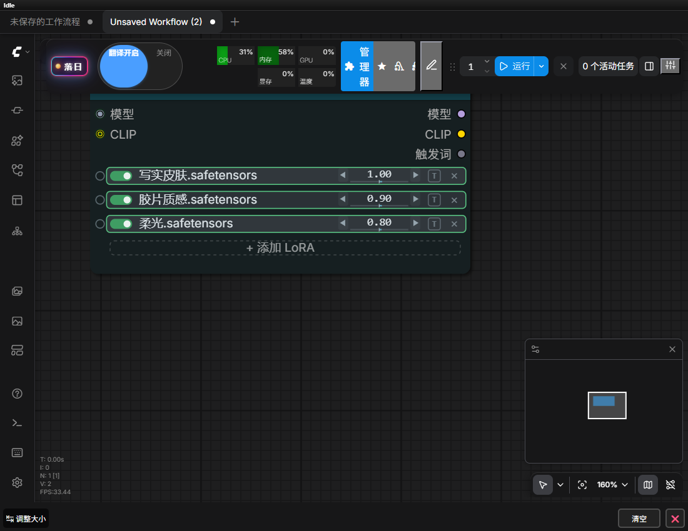
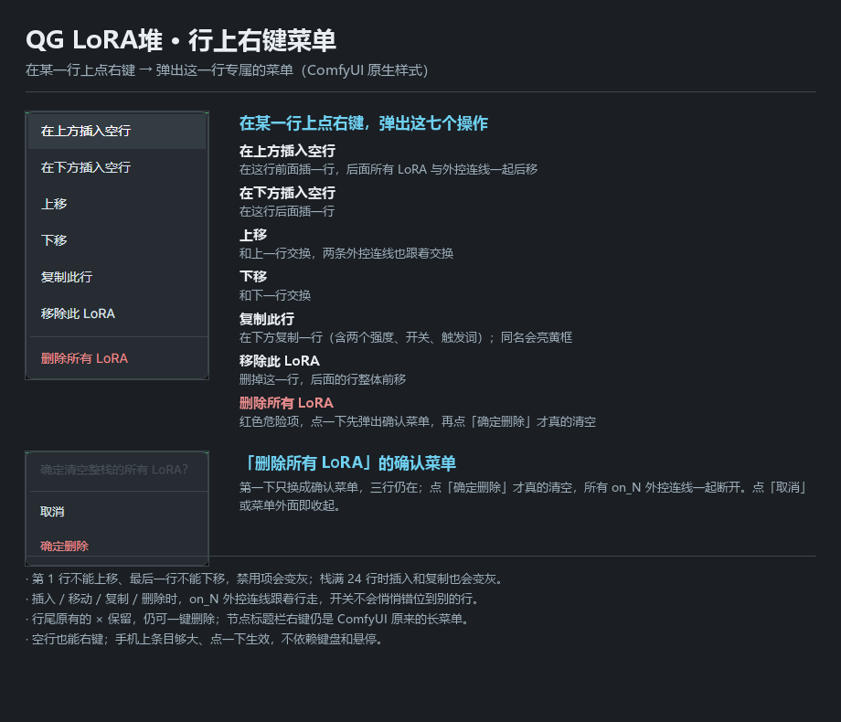
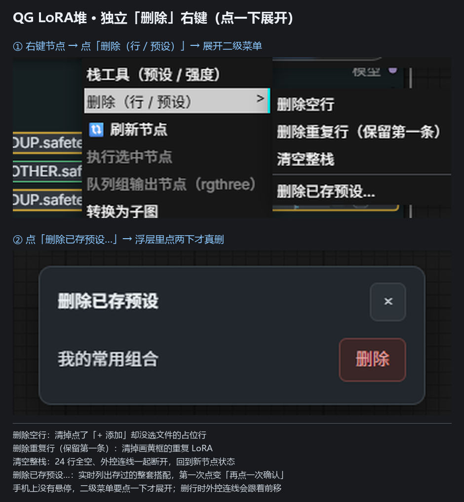
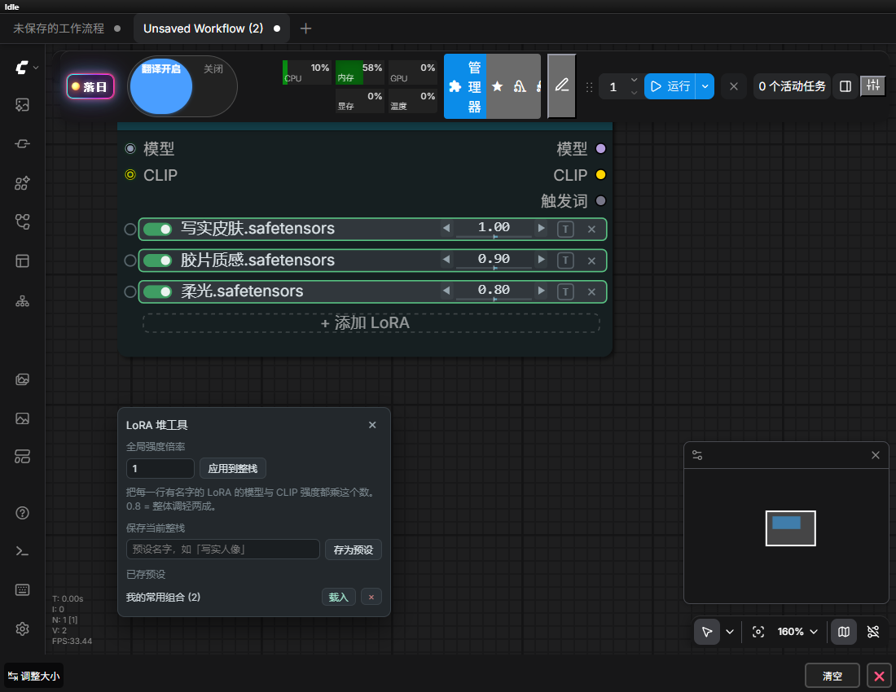
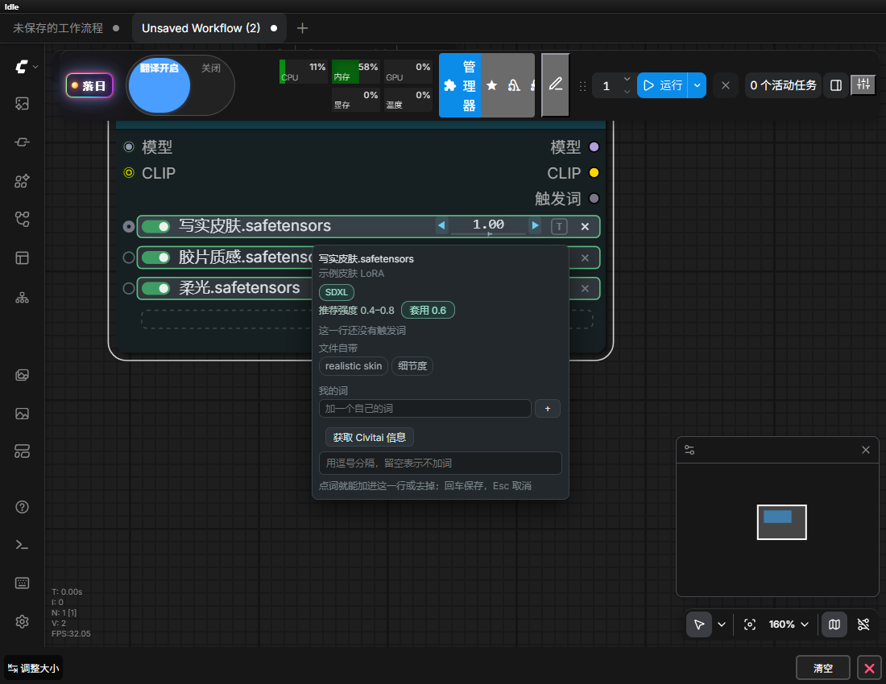

# QG LoRA堆 · 栈工具使用说明

适用版本：0.9.17（第一层扩展 + 行上右键菜单，2026-11-12/13）
适用节点：`QG_LoraSwitchStack` / 中文界面显示名「QG LoRA堆」

这一层加了四个功能，另外配了**行上右键菜单**（针对某一行）和一个**独立的「删除」右键菜单**（针对整栈），都是**在原来那个节点上操作**，没有新增节点，也没有改变节点的输入输出接口。你原来的工作流、存档、连线全部不用动。

> 生效方式：整层扩展改了后端（`nodes/_qg_lora_helpers.py` 新增了预设接口），
> 所以**需要重启一次 ComfyUI**。重启后浏览器按普通刷新即可（入口脚本不缓存）。
> 只刷新不重启的话，预设会保存失败，其余功能正常。
> 后面追加的「删除」右键、以及最后改成的「行上右键菜单」都只改前端，单独更新时普通刷新就够。

---

## 一、三个操作入口

| 入口 | 在哪儿 | 用途 |
|---|---|---|
| 行上右键菜单 | 在 LoRA 堆的**某一行**上点右键 | **单行操作**：插空行、上移下移、复制、移除、删全部 |
| 栈工具（预设 / 强度） | 节点右键菜单最上方 | 打开面板：存/取预设、全局强度倍率 |
| 删除（行 / 预设） | 节点右键菜单第二项 | **整栈批量**：删空行、删重复行、清空、删预设 |

「栈工具」点一下打开面板；「删除」要**再点一下**才展开二级菜单（手机没有悬停）。
在**某一行**上点右键，弹出的就是这一行的菜单，样式和 ComfyUI 自带右键菜单一样；在节点标题或空白处右键，仍然是 ComfyUI 原来的长菜单。

## 二、行操作菜单（在行上点右键）

**什么时候用**：想在第 2 行前面插一个 LoRA、把某几行换个顺序、复制一行做 A/B 对比，或者一键清空整个栈。以前只能删掉重建，现在直接在这一行上操作。

### 怎么打开

把鼠标移到想改的那一行，**点右键**（手机上一般是长按或双指点按，取决于浏览器）。菜单就出现在鼠标位置，是这一行专属的；空行也能右键，照样能插入、复制、换顺序。行尾不再有「三点」按钮，触发词 `T` 与删除 `×` 之间只留了一点空白。

菜单用的是 ComfyUI 原生右键菜单：悬停高亮、点外面收起、按 `Esc` 收起都由前端负责。点完一项自动收起；不想选就点菜单外面。

### 七项功能

| 选项 | 做什么 |
|---|---|
| 在上方插入空行 | 在这行**前面**插一行，后面所有 LoRA 与外控连线一起后移 |
| 在下方插入空行 | 在这行**后面**插一行 |
| 上移 | 和上一行交换，两条外控连线也跟着交换 |
| 下移 | 和下一行交换 |
| 复制此行 | 在下方复制一行（名字、两个强度、开关、触发词全带过去）；同名会亮**黄框**提醒 |
| 移除此 LoRA | 删掉这一行，后面的行整体前移 |
| 删除所有 LoRA | 红色危险项，点一下先弹出确认菜单，再点「确定删除」才真的清空 |

几个细节：

- **第 1 行不能上移、最后一行不能下移**，这两项会变灰，点了没反应。栈用满 24 行时，插入和复制也会变灰。
- **外控连线跟着行走**：插入时后移、删除时前移、上下移时交换，开关始终控制原来那个 LoRA，不会悄悄错位。真机专门验过。
- **行尾原有的 `×` 保留**，仍可一键删掉那一行；菜单里的「移除此 LoRA」是同一件事。
- 「删除所有 LoRA」是二次确认：第一下菜单原地换成「确定清空整栈的所有 LoRA？」加「取消 / 确定删除」，三行还在；点「确定删除」才清空，所有 `on_N` 外控连线一起断开。

## 三、独立删除右键菜单

**什么时候用**：24 行逐个去点行尾那个很小的 `×` 太累，手机上尤其难点中；或者想一次清掉空行、重复行、整个栈，以及删掉存错的预设。

### 怎么打开

1. 在 **QG LoRA堆 节点上点右键**。
2. 点 **「删除（行 / 预设）」**，二级菜单展开。
3. 直接点里面那一项，不用再进「栈工具」面板。

🔴 **手机上没有悬停**：二级菜单必须**点一下**才展开，光把手指停在上面不会出来。桌面端也一样（这是当前前端的菜单行为，不是本节点特有）。

### 四个选项

| 选项 | 做什么 | 会不会动外控连线 |
|---|---|---|
| 删除空行 | 清掉点了「+ 添加 LoRA」却没选文件的占位行，有名字的行自动收紧到前面 | 空行自己的线会断开，其余跟着前移 |
| 删除重复行（保留第一条） | 把画**黄框**的同名 LoRA 只留第一条 | 重复行的线断开，其余跟着前移 |
| 清空整栈 | 24 行全空、可见行归零，回到刚拖出来的新节点状态 | 所有 `on_N` 外控线一起断开 |
| 删除已存预设… | 打开一个轻量浮层，实时列出存过的整套搭配 | 不动节点 |

删完会在右上角弹一条中文提示，告诉你删了几行；没有可删的东西也会明确提示，不会静默无反应。

### 删行时连线怎么办

删掉中间某一行时，后面的行会整体前移，**接在 `on_N` 上的外控连线也会跟着一起前移**（比如原来接在第 3 行的线，删掉第 1 行后会落到第 2 行），开关不会悄悄控制到别的 LoRA 上。这一点在真机探针里单独验过。

### 删除已存预设

点「删除已存预设…」后，浮层出现在**节点下方的空白画布**，列出所有预设名，每条右边一个红色「删除」按钮：

- **第一次点**：按钮变成「再点一次确认」，预设**不会**被删；
- **第二次点**：才真正删掉，列表立刻刷新；
- 点浮层外面或右上角 `×` 关闭。

要两次确认是因为预设删掉不可恢复，手机上误触代价太高。日常只想快速删一个，也可以走「栈工具」面板里那个 `×`（那个是点一下就删）。

---

## 四、栈工具面板

点 **「栈工具（预设 / 强度）」** 打开面板。

面板默认出现在**节点下方的空白画布**，不会挡住你的 LoRA 行；点面板外面或右上角的 `×` 关闭。

面板里分三块：

| 区块 | 干什么 |
|---|---|
| 全局强度倍率 | 一次调轻 / 调重整栈所有行 |
| 保存当前整栈 | 给当前这套搭配起个名字存起来 |
| 已存预设 | 载入 / 删除以前存的搭配 |

---

## 五、整栈预设（存 / 取 / 删）

**什么时候用**：你调好一套 LoRA 组合（比如「写实人像」用 3 个 LoRA、强度各不同），想换个工作流接着用，或者想留个备份随时切回来。以前只能复制整个节点，现在存成预设就行。

### 保存

1. 右键节点 → 「栈工具」。
2. 在「保存当前整栈」下的输入框里填名字，例如 `写实人像`。
3. 点 **「存为预设」**。列表里立刻出现这个名字，括号里的数字是有几行 LoRA。

同名会**覆盖**，不会生成重复条目——改了强度直接再存一次同名即可。空栈不能存（会提示）。

### 载入

在「已存预设」列表里找到名字，点 **「载入」**：

- 每个 LoRA 回到**保存时所在的那一行**（空行占位也保留），`on_N` 外控连线不会因为载入预设而指到别的行；
- 没有内容的槽位清空，不会残留上一次的行；
- 11-12 之前存的老预设没有位置信息，仍按顺序铺到前几行（行为不变）；
- 节点高度自动重算，不会多出空行；
- 载入后面板自动关闭。

🔴 **载入会替换当前节点里的行**，不是追加。想保留当前搭配，先把它另存一个名字。

### 删除

点预设名右边的 `×`，后端记录一并删掉。

### 存在哪里

`ComfyUI 用户目录 / QG-tools / lora_stack_presets.json`，**跨工作流、跟着你的用户目录走**，不在工作流文件里。换电脑时把这个文件拷过去即可。最多 60 个预设、每个名字最多 60 字、每份最多 24 行。

安全性：读写用同一把锁、先写临时文件再原子替换；文件损坏时**拒绝覆盖**并报错，不会把你已经存好的预设清空。

---

## 六、全局强度倍率

**什么时候用**：一整套 LoRA 整体太浓 / 太淡，想统一压到八成，不想一行一行拖 24 次。

1. 右键 → 「栈工具」。
2. 「全局强度倍率」输入框里填倍数，例如 `0.8`。
3. 点 **「应用到整栈」**。

- 每一行**有名字的 LoRA** 的「模型强度」和「CLIP 强度」都会乘这个数；
- 结果仍受原来的强度上下界限制；
- 空白行不动（不会被悄悄改成 0.8）；
- 只接受大于 0 的数，填 0 或负数会提示。

🔴 这是**一次性操作**，直接把结果写进每一行，面板里没有"恢复到 1.0"的按钮。想反悔就填倒数（0.8 之后填 `1.25`），或者用上一节的预设：先存一份，调完不满意再载入回来。

> 实现说明：倍率是前端把每行强度算好后写回 `rows_data`，后端接口一个字没改。所以缓存、存档格式、节点登记都不受影响，也不会和 `on_N` 外控开关打架。

---

## 七、推荐强度一键套用 + 底模徽标（在触发词卡片里）

**什么时候用**：你给某个 LoRA 存过推荐强度区间，或者想知道这个 LoRA 到底是给哪个底模训的（喂错底模是最常见的"加了没效果"原因）。

1. 点**行尾那个带 T 的小方块**（行尾 `×` 左边），打开触发词卡片。
2. 卡片顶部现在多了一行元信息：

| 元素 | 含义 |
|---|---|
| 彩色徽标（如 `SDXL`、`Flux`） | 这个 LoRA 声明的底层模型。没声明就不显示 |
| `推荐强度 0.4–0.8` | 你以前在信息卡里存过的推荐区间 |
| `套用 0.6` 按钮 | 把这一行的模型强度和 CLIP 强度都设成区间中值 |

3. 点 **「套用 0.6」**，这一行两个强度立刻变成 0.6，按钮变成「已套用」。

几个细节：

- 底模和推荐区间都来自插件**早就有的** `/qg/lora/info` 数据（文件元数据 + Civitai 侧车 + 你自己存的配置），没有新增联网请求；服务器从不访问 Civitai。
- 只设了区间一端（比如只有上限 0.8）也能用，中值按那一端算。
- 套用**只改当前这一行**，不影响别的行。
- 底模徽标是**提示**，不是校验：插件不会阻止你把 SDXL 的 LoRA 接到 Flux 上。真正"一个权重都没打上"时，后端仍会照常在控制台给警告。

---

## 八、常见问题

**问：右键菜单里找不到「栈工具」或「删除」？**
多半是浏览器还在用旧脚本。重启 ComfyUI 后按 `Ctrl+Shift+R` 强制刷新一次。

**问：点了「删除」没反应、没列出选项？**
二级菜单要**再点一下**才展开，悬停不会展开（手机尤其注意）。

**问：存预设没反应 / 提示失败？**
基本都是没重启 ComfyUI——后端新增的接口还没加载。重启后重试。

**问：节点在新版节点界面（Nodes 2.0）下能用吗？**
能。这四个功能都在节点右键菜单和 DOM 面板里，与画布渲染方式无关；已通过 65 节点全量体检，零失败。

**问：行菜单在哪儿？行尾怎么没有按钮了？**
按用户要求改成了**右键菜单**，行尾的三点按钮已经去掉。想改哪一行就在那一行上点右键；节点标题栏、空白画布上右键仍是 ComfyUI 原来的菜单。整栈批量操作请用节点右键里的「栈工具 / 删除」两项。

**问：手机上怎么操作？**
面板和预设删除浮层是普通网页浮层，按钮够大、可以点、可以输入文字，不依赖键盘和悬停；行菜单用的是 ComfyUI 原生右键菜单，条目的点击区域同样是整行宽，点一下就生效，不依赖悬停。节点右键的二级菜单点一下就展开，行菜单里的「删除所有 LoRA」也是点一下才弹确认。

---

## 九、验证情况（给开发者）

- 后端单测 `tools/_check_lora_presets.py`：**28 项**，覆盖读写、同名覆盖、删除、条数上限（按时间淘汰）、坏文件保护、外来字段剥离、空行槽位保留、±inf 强度。
- 结构守卫 `tools/_check_lora_switch_stack.py`：**170 项**，含删除菜单、行上右键菜单、以及全节点复核修掉的数据/异步/坐标缺陷断言，多组负例自检。
- 端到端真机探针 `tools/_probe_lora_stack_layer1.cjs`：14 项全过（真调后端路由、真点 DOM、真写回 `rows_data`）。
- 删除菜单专项真机探针 `tools/_probe_lora_stack_delete.cjs`：23 项全过，含真实右键点击展开二级菜单、三个行删除动作、外控连线从 `on_3` 前移到 `on_2`、预设删除二次确认。
- **行操作菜单专项真机探针 `tools/_probe_lora_row_menu.cjs`：36 项全过**，含真实右键命中、原生菜单样式与行号、左键负例、节点标题右键不被抢、七项文案与禁用态、插入时连线后移、上移下移时连线来源互换、复制行独立性、删除全部二次确认、点外面关闭、新版节点界面、空行右键。
- **边界真机探针 `tools/_probe_lora_row_menu_edge.cjs`：8 项全过**（画布缩放 1.6 + 平移后的命中、两个 LoRA 堆重叠取最上层、折叠节点不误命中、连续右键不叠加、只派发 contextmenu 的触屏长按、真实鼠标点击菜单项、Esc 关闭、预设空行槽位保留）。
- 全节点复核（11-12 晚）另跑：加载器单测 162 项、共享逻辑单测 32 项、加载器 UI/菜单真机探针，全部通过。
- 回归复跑：LoRA 堆既有全项探针、第一层四项探针、删除菜单探针、八状态行宽体检、模式切换残留探针全部通过；65 节点 Nodes 2.0 全量体检失败 0 条。
- 静态校验：前端语法 92 个文件零失败、汉化校验、来源徽标、声明一致性全过；全量静态回归因执行时长被环境中断，已改为逐项跑关键检查，全部通过。
- 三个专项真机探针都登记在 `regress.py` 的真机清单里（`--fast` 下跳过，`--live-only` 单独跑）。
